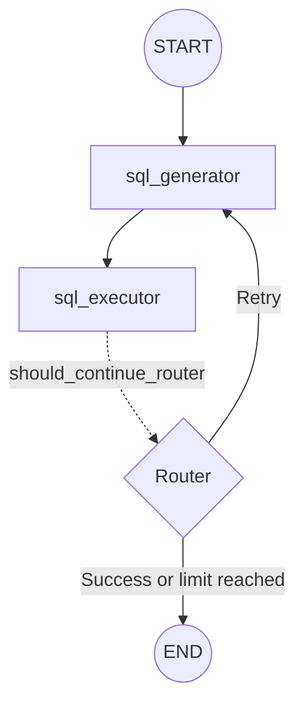

# 🕸️ nano-graph (v2.0)

A lightweight, cyclic state-machine engine for building AI agent workflows in Python, inspired by LangGraph and Google ADK.

## ✨ Core Engine Capabilities

- **Cyclic State-Graph Execution (`StateGraph`):** Supports direct edges, conditional routers, and `max_steps` protection.
- **State Checkpointing (`MemoryCheckpointer`):** Stores deep-copied state snapshots after node execution for inspection and recovery workflows.
- **Human-in-the-Loop Breakpoints (`interrupt_before`):** Pauses execution before selected nodes so state can be inspected before continuing.
- **Mermaid Topology Compiler (`to_mermaid()`):** Generates Mermaid flowchart syntax from registered graph nodes and edges.

## 📐 SQL Agent Architecture

The `demo_sql_agent.py` example uses an LLM to generate SQL, executes the query against SQLite, and retries when a database error occurs.



GitHub automatically renders this Mermaid diagram when someone visits the repository's README.

## 🚀 Quickstart

Activate your Python virtual environment and install the dependencies required by the demo.

```bash
pip install groq python-dotenv
```

Run the tests:

```bash
pytest -v
```

Run the SQL agent demo:

```bash
python demo_sql_agent.py
```

## 📁 Project Structure

```text
nano-graph/
├── engine.py
├── checkpoint.py
├── demo_sql_agent.py
├── test_engine.py
└── README.md
```

The files shown above describe the expected project layout; adjust this list if your repository differs.

## 🛠️ Development

Run the test suite after modifying the graph engine:

```bash
pytest -v
```

Before running the SQL demo, configure your Groq API credentials in your environment and ensure that `company.db` contains the expected `employees` table.

